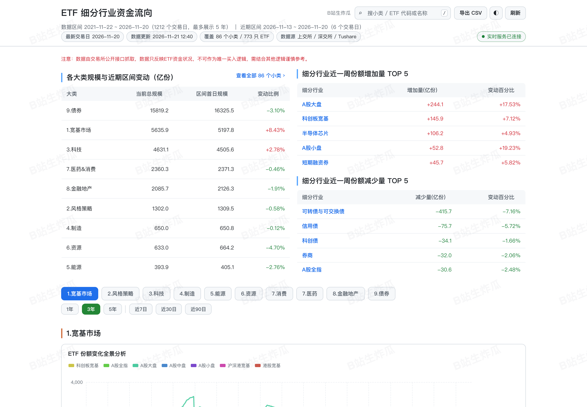
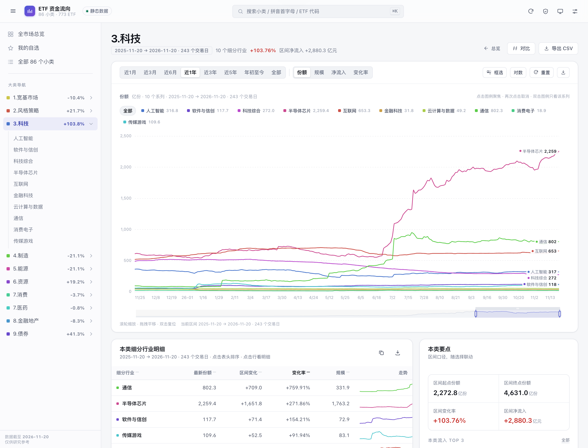

<p align="center"></p>

<h1 align="center">Ebbflow</h1>
<p align="center"><b>ETF 细分行业资金流向</b>：沪深全市场 ETF 的规模、净申购与变化率看板</p>

潮有两次涨落，日复一日；资有几番进出，朝来暮往。
海以潮汐写时间，市以资金写暗流。

**Ebbflow** 取自 *ebb & flow*：ebb 是退潮，flow 是涨潮，合在一起就是潮水的起落。
钱在 ETF 里也是这样进出——申购涌进来，赎回退回去，日复一日；把这份起落画成曲线，名字便由此而来。

它每天把沪深两市全部 ETF 的份额、净值、行情抓下来，落进本机 SQLite，按行业与主题归堆；
打开就能看，也可以离线看。数据来自上交所与 Tushare Pro，仅供研究与技术学习，不构成投资建议。

[](LICENSE)
[](package.json)
[](https://github.com/li2396803/ebbflow/actions/workflows/update.yml)
[](https://li2396803.github.io/ebbflow/)
[](https://github.com/deepseek-ai/deepseek-harness)





## 特性

- 两套分类口径：v2（7 大类 / 72 小类 / 1903 只）与 legacy（10 / 88 / 1614），右上角切换。
- 三个指标：**规模（亿元）**、**净申购（亿元/日）**、**变化率（%）**，聚焦时可任选组合。
- **不展示份额**：份额不可跨标的相加（债券 ETF 面值 100 元、股票 ETF 面值 1 元），详见 [docs/METRICS.md](docs/METRICS.md)。
- 新访客默认看**近一年**、图表默认**叠加模式**（也可一键切「分面」，各指标独立成栏）。
- 全市场总览：沪深两市规模走势、净申购与按基金类型的规模分布。
- 两源数据：交易所官方份额（沪/深），加 Tushare 的份额兜底、净值、名录、行情；本地 SQLite 缓存。
- 校验与回归：`reconcile` 对 Tushare 做双口径交叉校验，`verify:origin` 对原看板做逐点回归。
- 零运行时依赖；构建注入 modulepreload，本地服务对 JSON/JS/CSS 开 brotli。

## 快速开始

前提：Node.js ≥ 22.5（需要内置 `node:sqlite`）。

Windows：命令用 `npm.cmd` / `npx.cmd`，构建前端前先 `npm install`；定时任务与常见报错见 [`docs/WINDOWS.md`](docs/WINDOWS.md)。

```bash
git clone https://github.com/li2396803/ebbflow.git
cd ebbflow
cp .env.example .env      # 写入 TUSHARE_TOKEN
npm start                 # http://127.0.0.1:5188
```

验证环境：

```bash
node -v                                                     # 需 ≥ 22.5
node -e 'console.log(Object.keys(require("node:sqlite")))' # 能打印导出即支持
```

首次启动是空库，先灌一次数据：

| 方式 | 命令 | 说明 |
| --- | --- | --- |
| 全量回补 | `npm run backfill` | 建 5 年历史，耗时取决于积分与网络 |
| 只跑增量 | `npm run update` | 只补最近 15 个交易日，先看效果 |

常用环境变量：

| 变量 | 默认 | 作用 |
| --- | --- | --- |
| `TUSHARE_TOKEN` | 无 | Tushare Pro 的 token，也可写在 `.env` |
| `PORT` | `5188` | 本地服务端口，只绑 `127.0.0.1` |
| `TUSHARE_RPM` | `120` | 每分钟调用上限 |
| `TUSHARE_MAX_CALLS_PER_RUN` | `800` | 单次运行调用上限，超出即停 |
| `TUSHARE_DAILY_BUDGET` | `4000` | 每日调用预算，计数落库 |

`data/etf.db` 是唯一需要保留的本地状态，可随时由接口重建。换机器时拷贝这个文件即可跳过回补。

## 数据与方法

**交易所优先，Tushare 兜底**（含一道哨兵：交易所返回空但 Tushare 有数据时，判定为接口异常并自动兜底）。份额这类会每日变动的数据直接取交易所公开接口，净值/名录/行情与校验用 Tushare：

| 来源 | 接口 | 用途 | 特点 |
| --- | --- | --- | --- |
| 上交所 | `commonQuery.do`（`STAT_DATE` 可回溯任意交易日） | 沪市每日份额 | 官方口径，比数据商晚 |
| 深交所 | `ShowReport/data`（CATALOGID=1105，只给最新报告日） | 深市每日份额 | 快，历史靠回补 |
| Tushare Pro | `fund_share` / `fund_nav` / `fund_basic` / `fund_daily` | 净值（规模与净申购的唯一来源）、名录、行情、**缺口补齐与交叉校验** | 有频率限制 |

同一代码同一天只保留一行，写入按来源优先级裁决：

| 来源 | 优先级 | 说明 |
| --- | --- | --- |
| `sse` / `szse` | 1 | 交易所披露口径，覆盖 Tushare |
| `ts` | 2 | 第三方：补缺、净值、校验；交易日轴以沪市官方数据为准 |

**发布时刻**：上交所按官方口径在 **T+1 日 08:00** 前后发布当日份额；深交所当日约 **21:00** 就有最新快照。
所以云端工作流这样排：

- 工作日 **22:00**（北京）：先取深交所当日快照（此时沪市还没出，只写深市）
- **周二~周六 08:00**（北京）：上交所发布后主抓，沪市数据到位，当天正式成为「完整交易日」

更新是幂等的，多跑只覆盖同样的值，不会重复计数。

四条口径要点：

- **债券 ×100**：债券 ETF 面值 100 元/份，v2 的 `bond` 与 legacy 的 `9_债券` 都按 100 折算。
- **规模**：`Σ(份额 × 单位净值)`，单位亿元；可跨标的、跨类别相加。
- **净申购**：`Σ(份额_t − 份额_{t−1}) × 净值_t`，单位亿元/日；只计一级市场申赎，二级买卖不改变份额。
- **变化率**：区间规模变化率；与净申购并列时满足 `规模变化率 ≈ 净申购/期初规模 + 净值涨跌`。
- **剔除假跳变**：拆分/合并按 `event` 表（254 起）换算到当前份额单位后再做差；上市首日不计入净申购。

当前库规模：1212 个交易日（2021-11-22 ~ 2026-11-20），13 张表，名录 3019 只基金。
公式、字段与已知偏差见 [`docs/DATA.md`](docs/DATA.md)。

## 分类体系

| 口径 | 大类 | 小类 | ETF | 序列表 | 目录 |
| --- | --- | --- | --- | --- | --- |
| v2（默认） | 7 | 72 | 1903 | `series_v2` | `site/data/` |
| legacy | 10 | 88 | 1614 | `series` | `site/data/legacy/` |

v2 的大类是指数类别：宽基、行业、主题、策略风格、债券、跨境、商品。小类由申万一级行业与主题清单组成，
依据 `index_basic.category`、申万名称映射与主题关键词逐条生成。

legacy 是原看板的 10 个大类与 86 个细分行业（773 只沪市成分），叠加按跟踪指数与关键词规则归属的深市成分。
原看板基线冻结在 `lib/taxonomy.mjs`，回归校验依赖它。

两套互不覆盖，切换写进 URL（`?taxonomy=legacy`），接口前缀分别为 `/api/*` 与 `/api/legacy/*`。
归类规则、争议项与排除清单见 [`docs/CLASSIFICATION.md`](docs/CLASSIFICATION.md)。

## 命令

全部定义在 `package.json`。运行站点不需要安装依赖；重建前端（`npm run build`）需先 `npm install`（Vite）。

| 命令 | 作用 | 联网 |
| --- | --- | --- |
| `npm start` | 起本地服务，默认 `127.0.0.1:5188`；`PORT` 改端口，`--no-refresh` 关自动刷新 | 按需 |
| `npm run update` | 增量更新：Tushare 当日份额/净值/行情 + 折算检测 + 上交所近 15 日 → 重算 → 构站 | 是 |
| `npm run build` | 只用本地库重建 `site/`；空库时用 `data/series.json` 冷启动 | 否 |
| `npm run backfill` | 全量回补份额历史，支持 `--from` `--to` `--source` `--limit` `--dry-run` `--no-resume` | 是 |
| `npm run quotes` | 回补行情历史（折溢价、成交额、换手率的数据源），按日增量、跳过已有日期 | 是 |
| `npm run reconcile` | 双口径交叉校验，写 `data/quality.json`；退出码 0/1/2 | 是 |
| `npm test` | 数据校验用例：口径、来源优先级、规则、连续性、数值范围 | 否 |
| `npm run verify:origin` | 与原看板已发布序列逐点对比 | 否 |
| `npm run lint` | 仓库自检：语法、密钥、占位符、产物边界、数据底座 | 否 |

常用参数：

```bash
npm run reconcile -- --days 60           # 往回看 60 个交易日
npm run reconcile -- --date 2026-11-20   # 只看某一天
npm run reconcile -- --no-write          # 只看结果，不写库与文件
npm run backfill -- --source ts --from 2021-11-22
npm run verify:origin -- --json out.json # 默认写 data/validation-origin.json
```

本机常驻与定时任务用 `bin/` 下的脚本（macOS/Linux；Windows 用任务计划程序，见 [`docs/WINDOWS.md`](docs/WINDOWS.md)）：

| 脚本 | 作用 |
| --- | --- |
| `bin/start.sh` / `bin/stop.sh` | 后台起停服务，pid 与日志写入 `.run/` |
| `bin/status.sh` | 一屏显示进程、自启、库规模与最近更新 |
| `bin/update.sh` | 调 `npm run update`，带锁、失败重试一次，日志写 `.run/update.log` |
| `bin/install-autostart.sh` / `bin/uninstall-autostart.sh` | 安装或卸载 macOS LaunchAgent，支持 `--dry-run` |

## 架构与目录

```
ebbflow/
├── lib/
│   ├── sources.mjs      上交所接口（UA、翻页、重试、限并发）
│   ├── tushare.mjs      Tushare 接口（令牌桶、预算、退避）
│   ├── db.mjs           SQLite 存储层，建表与幂等迁移
│   ├── pipeline.mjs     合并落库、折算检测、重算派生表
│   ├── payloads.mjs     派生站点载荷
│   ├── build/site.mjs   构站：写 data/、拷贝 web/、注入签名与 modulepreload
│   ├── universe.mjs     legacy 宇宙合并与 v2 分类加载
│   └── validate.mjs     数据质量规则
├── scripts/             更新、回补、校验、构站、分类生成、自检
├── server/app.mjs       静态托管、/api/*、压缩缓存
├── web/                 前端源码（原生 JS，本地 ECharts）
├── site/                构建产物（data/ 不入库）
├── data/                SQLite 缓存与数据快照
├── tests/               数据校验测试
└── docs/                数据、接口、分类、部署文档
```

数据流：上交所与 Tushare → `lib/pipeline.mjs` 合并落库 → `lib/db.mjs`（SQLite）→ `lib/payloads.mjs` 派生载荷 → `lib/build/site.mjs` 写 `site/`。前端静态优先、`/api/*` 兜底。

构建与传输细节：

- `subs.json` 的交易日轴只存一份，放在顶层 `__dates`，前端加载时剥离，避免被当成小类。
- 构站时把 `web/js` 下的模块写入 `<link rel="modulepreload">`，消除 ESM 串行发现的请求瀑布。
- 本地服务对 JSON/JS/CSS 预压缩，优先返回 brotli，客户端不支持时回退 gzip。

更多文档：

- 模块职责与设计取舍：[`docs/ARCHITECTURE.md`](docs/ARCHITECTURE.md)
- 端点与 JSON 字段：[`docs/API.md`](docs/API.md)
- SQLite 表结构与来源：[`docs/DICTIONARY.md`](docs/DICTIONARY.md)

## 自动化与部署

| 通道 | 触发 | 做什么 |
| --- | --- | --- |
| GitHub Actions `update.yml` | 每工作日 21:30（北京时间）+ 次日 08:30 兜底 | 校验密钥 → 增量更新 → 测试 → 提交数据快照 → 发布 Pages |
| GitHub Actions `ci.yml` | push / PR | 测试、离线构建、校验站点产物 |
| GitHub Actions `pages.yml` | 手动 | 单独部署一次站点 |
| 本机 launchd | 登录自启 + 每工作日 16:10 | 起服务、跑增量更新，日志写入 `.run/` |

补充说明：

- Fork 后必须在仓库 Secret 里配置 `TUSHARE_TOKEN`，否则工作流第一步直接失败，不会静默降级。
- SQLite 库不进 git：CI 用 `actions/cache` 跨运行传递，或用 Release 里的种子库冷启动。
- 每日提交只包含 `site/` 与 `data/*.json` 快照；运行产物与数据库都在 `.gitignore` 里。
- 定时任务在整点附近排队，实际触发可能比 16:30 晚几分钟到几十分钟。

完整步骤与常见问题见 [`docs/FORK.md`](docs/FORK.md)。

## 数据质量与校验

`reconcile` 比较同一天的交易所口径与 Tushare 口径，按 0.1% / 1% 分档；`verify:origin` 用自建数据复算原看板序列。

最近一次结果：

| 检查 | 结果 |
| --- | --- |
| 逐只比对（`reconcile`） | 3730 对全部一致，`gt1` 为 0 |
| 小类层（`reconcile`） | 430 项无不一致 |
| 回归对比（`verify:origin`） | 95,389 个点，99.83% 一致 |

差异处理原则是不改数：重跑更新，或记录在案。手改 `series` 会让数据无法重建。
`quality.json` 的字段说明见 [`docs/DATA.md`](docs/DATA.md)。

## 已知限制

1. **深市历史只能来自 Tushare**。深交所官方接口只有最新快照，已不再调用；看板为沪深合并口径，数值大于原看板（仅沪市）。
2. **Tushare 需要 token 与积分**。没有 token 时 `npm run update` 仍可运行，但只有沪市数据，交叉校验以退出码 2 结束。
3. **库与站点数据不入库**。新克隆用 `data/series.json` 冷启动，能出曲线但成分明细为空；`site/data/` 需要 `npm run build` 生成。
4. **份额不等于资金流**。净流入是按当日净值折算的估算值，已剔除折算与上市首日，仍不含折溢价与申赎清单效应。
5. **净值覆盖因口径而异**：原看板 773 只约 98%，legacy 1614 只约 91%，v2 1903 只约 85%；缺净值的成分不计入规模与净流入。
6. **行情历史仍在回补**：目前约 297 个交易日有行情，未覆盖日期的折溢价、成交额、换手率为空。
7. **原看板有两个冻结日**：2026-08-25 与 2026-10-28，原站数值停在前一日；本项目从交易所重抓，两边一致率仍达 99.83%。
8. **单实例、无鉴权**。服务只绑 `127.0.0.1`，不要暴露到公网；抓取保持每日一次、并发 ≤ 6。

## 贡献

欢迎 Issue 与 PR：口径修正、文档纠错、前端可用性、工作流改进。

提交前跑：

```bash
npm test          # 数据校验用例
npm run lint      # 仓库自检
```

提交前确认：

- [ ] `npm test` 与 `npm run lint` 均通过
- [ ] 数据类改动附 `reconcile` 输出
- [ ] 没有提交 `.env`、`data/etf.db`、`site/data/`

数据类 PR 需附 `reconcile` 输出，且不要手改 `data/series.json`。细则见 [`CONTRIBUTING.md`](CONTRIBUTING.md)，
行为准则见 [`CODE_OF_CONDUCT.md`](CODE_OF_CONDUCT.md)，安全问题走 [`SECURITY.md`](SECURITY.md)，
提问前先看 [`SUPPORT.md`](SUPPORT.md)。

## 鸣谢

分类体系、指标口径与看板形态来自哔哩哔哩 UP 主**生炸瓜**的《ETF 细分行业资金流向》看板。

- B 站：<https://space.bilibili.com/3546681834473583>
- GitHub：<https://github.com/ysz-xiao>

代码为独立重写，与原作者无隶属或背书关系。署名与再分发说明见 [`NOTICE.md`](NOTICE.md)。

## 许可与免责

MIT 协议，见 [`LICENSE`](LICENSE)。保留版权与许可声明即可自由使用、修改、再分发。

数据来自公开接口与第三方服务，可能延迟、缺失或出错。项目只做聚合与展示，
不构成投资建议、要约或推荐；据此决策的后果由使用者自行承担。
